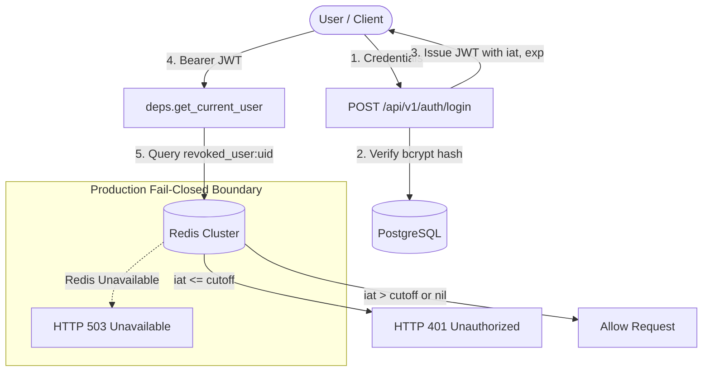

# PariView Security Architecture Specification

## 1. Executive Summary

PariView implements a defense-in-depth security model designed to safeguard personal financial records, transactional data, bank statements, and authentication sessions. The application strictly adheres to the principle of least privilege, zero-trust session revocation, multi-tenant resource isolation, and statistical anomaly detection invariants.

---

## 2. Authentication & Session Management



### 2.1 Privilege Escalation Prevention
- Public user registration schema (`UserCreate`) completely excludes the `role` field.
- Server-side creation logic in `endpoints/auth.py` hardcodes `role="user"`.
- Administrative rights are reserved exclusively for accounts manually provisioned or escalated through secured administrative channels.

### 2.2 Password Policy Enforcement
All password creation and update workflows pass through `validate_password_strength()`:
- Minimum length: 8 characters.
- Requires at least 1 uppercase letter ($[A-Z]$).
- Requires at least 1 lowercase letter ($[a-z]$).
- Requires at least 1 numeral ($[0-9]$).
- Requires at least 1 special character ($[!@\#\$%\^&\*\(\)_\+\-=\[\]\{\};':",<>\./?]$).
- Password change requires verification of authenticated user's current password.
- Re-use of the current password is strictly prohibited (returns HTTP 400).
- Passwords are hashed using bcrypt with an automatically generated salt; cleartext passwords are never logged or stored.

### 2.3 Distributed Token Revocation & Fail-Closed Behavior
- In multi-worker deployments, token invalidation (e.g. on logout or password change) must propagate instantly across all worker processes.
- Revocation records are written to shared Redis with key format `revoked_user:{user_id}` and a cutoff timestamp equal to the revocation event.
- Every authenticated request evaluates the token's `iat` (issued-at) against the cutoff timestamp in Redis.
- **Fail-Closed Policy**: If Redis is offline or unreachable in production, `is_token_revoked()` raises `RevocationStoreUnavailableError`. The application dependency translates this into `HTTP 503 Service Unavailable`, preventing potentially compromised or revoked tokens from accessing sensitive user data.
- Process-local in-memory revocation (`_REVOKED_USERS`) is strictly restricted to `ENVIRONMENT=development`.

---

## 3. Rate Limiting Architecture

PariView enforces tiered rate limits managed by `app.middleware.rate_limit.RateLimitMiddleware`:

| Tier | Window | Limit | Target Endpoints | Fallback on Redis Outage |
|---|---|---|---|---|
| **AUTH** | 60 sec | 10 req | `/api/v1/auth/login`, `/register`, `/forgot-password` | **Fail Closed (HTTP 503)** |
| **UPLOAD** | 60 sec | 10 req | `/api/v1/uploads`, `/receipts/upload`, `/ocr` | **Fail Closed (HTTP 503)** |
| **ANALYTICS** | 60 sec | 20 req | `/api/v1/analytics/ai-forecast`, `/categorize`, `/insights` | **Fail Closed (HTTP 503)** |
| **DEFAULT** | 60 sec | 100 req | Standard CRUD endpoints | Degrades gracefully (In-memory IP bucket) |

- **State Storage**: Redis sliding/fixed-window counters with automatic TTL expiration.
- **Identity Resolution**: Authenticated User ID takes precedence; unauthenticated requests fall back to client IP extracted from `request.client.host`. Spoofed proxy headers without verified upstream trust are ignored.
- **Response**: Exceeded limits return `HTTP 429 Too Many Requests` accompanied by a standard `Retry-After: <seconds>` header.

---

## 4. Multi-Tenant Storage & Upload Isolation

```
uploads/
└── users/
    ├── 1/
    │   ├── statement_2026_01.pdf
    │   └── receipt_feb.png
    └── 2/
        └── bank_record.csv
```

1. **Unmounted Direct Static Routes**:
   Direct static mounts (`/uploads`) are permanently eliminated from FastAPI routing. Direct URL path traversals result in `HTTP 404 Not Found`.

2. **Per-User Scoped Directories**:
   All files must reside under `uploads/users/{user_id}/`. File keys are cleansed using `os.path.basename` and checked for path traversal characters (`..`, `/`, `\`).

3. **HMAC-SHA256 Signed URLs**:
   Temporary direct access is granted exclusively through cryptographically signed URLs:
   - Parameters: `path`, `expires`, `user_id`, `signature`.
   - Signature: `HMAC_SHA256(SECRET_KEY, f"{path}:{expires}:{user_id}")`.
   - Expired or tampered signatures return `HTTP 401 Unauthorized`.
   - Access to another user's file returns `HTTP 403 Forbidden`.

4. **Temporary File Scrubbing**:
   Files processed for OCR or bank statement parsing (e.g. `pdfplumber`, `pytesseract`) are processed in temporary files and guaranteed cleaned up in `finally:` blocks.

---

## 5. Statistical Anomaly Detection (MAD Engine)

PariView utilizes Median Absolute Deviation (MAD) rather than standard deviation to detect transaction anomalies without being skewed by legitimate large expenses or recurring baseline spikes:

$$
\text{MAD} = \text{median}(|x_i - \tilde{x}|)
$$

$$
\text{Modified } Z = \frac{0.6745 \cdot (x - \tilde{x})}{\text{Scale}}
$$

### 5.1 Zero-MAD Floor & Stability Invariants
In recurring predictable spending (e.g., rent, Netflix, subscriptions), identical transactions result in $\text{MAD} = 0$. In standard implementations, division by zero produces unbounded $Z$-scores or false positive alerts.
- **Resolution**: PariView computes Mean Absolute Deviation as an auxiliary dispersion measure, and enforces a conservative scale floor:
  $$
  \text{Scale} = \max(\text{MAD}, 0.1 \cdot \overline{\text{MAD}}, 1.0)
  $$
- Recurring subscriptions ($\pm 5\%$ variation) produce zero false positives ($Z < 3.5$).
- Genuine spending shocks ($\ge 3.5\times$ baseline) reliably trigger anomaly flags ($Z \ge 3.5$).
- Category-specific baselines prevent grocery spikes from triggering alerts calibrated on utility bills.
