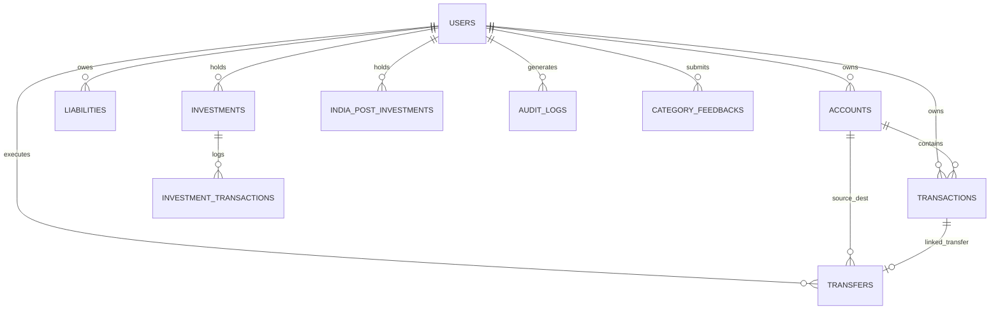

# PariView Database Architecture & Entity Specifications

**Version:** 2.0-Hardened  
**Date:** September 2026  

---

## 1. Schema Diagram & Core Relational Architecture

PariView's database architecture is built on PostgreSQL / SQLite using SQLAlchemy ORM and Alembic migrations.

---

## 2. Table Specifications & Monetary Precision

| Table Name | Primary Key | Monetary Columns | Data Type & Precision |
| :--- | :--- | :--- | :--- |
| `accounts` | `id` | `balance` | `Numeric(14, 2)` |
| `transfers` | `id` | `amount` | `Numeric(12, 2)` |
| `liabilities` | `id` | `total_amount`, `remaining_amount`, `minimum_payment` | `Numeric(14, 2)` / `Numeric(12, 2)` |
| `transactions` | `id` | `amount`, `balance`, `debit_amount`, `credit_amount` | `Numeric(12, 2)` / `Numeric(14, 2)` |
| `investments` | `id` | `quantity`, `purchase_price`, `current_price` | `Numeric(14, 4)` |
| `india_post_investments` | `id` | `amount`, `interest_rate` | `Numeric(12, 2)` / `Numeric(5, 2)` |
| `budgets` | `id` | `amount` | `Numeric(12, 2)` |
| `savings_goals` | `id` | `target_amount`, `current_amount` | `Numeric(12, 2)` |
| `subscriptions` | `id` | `amount` | `Numeric(12, 2)` |
| `receipts` | `id` | `total_amount`, `tax_amount` | `Numeric(12, 2)` |

---

## 3. Duplicate Protection Fingerprinting

Transactions maintain a SHA-256 fingerprint column (`fingerprint VARCHAR(64)`):

$$\text{Fingerprint} = \text{SHA256}(\text{account\_id} \mathbin{\Vert} \text{date} \mathbin{\Vert} \text{amount} \mathbin{\Vert} \text{clean\_narration} \mathbin{\Vert} \text{ref\_num})$$

Indexed on `ix_transactions_fingerprint` to enforce fast duplicate lookup during CSV/PDF statement imports.
